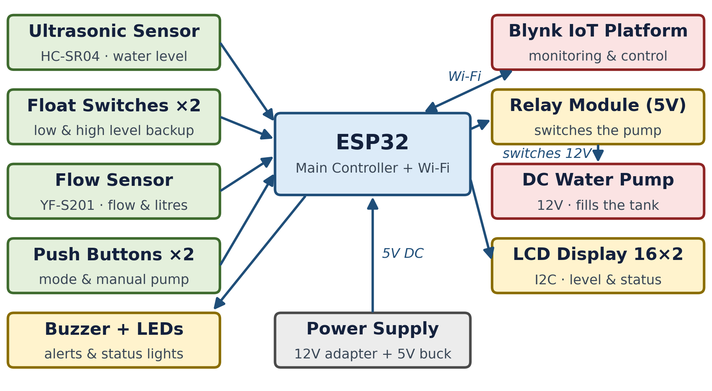

# Smart Water Tank & Intelligent Pump Controller

An ESP32-based system that automatically monitors a water tank's level and controls the pump — with overflow protection, dry-run protection, leakage detection, and mobile monitoring and control through the Blynk IoT platform.

> CSE 382 — Introduction to Embedded Systems Lab, Section 11, Group 6, Spring 2026, Southeast University.
> Status: project proposal (design stage). Full proposal: [Smart_Water_Tank_Proposal.pdf](Smart_Water_Tank_Proposal.pdf)

## Features

1. Automatic water level detection
2. Automatic pump ON/OFF control (ON at ≤ 20% level, OFF at ≥ 95%)
3. Water tank overflow protection (high float switch)
4. Dry-run protection (pump stops if no flow for 10 seconds)
5. Water leakage detection (flow while the pump is off)
6. Real-time water flow monitoring
7. Mobile-based water level monitoring (Blynk)
8. Remote pump ON/OFF control
9. Automatic and manual operating modes
10. Low water level alert
11. Tank full notification
12. LCD-based water level display (16×2 I2C)
13. Real-time pump status monitoring
14. Daily water consumption tracking
15. Emergency fault detection and alert system
16. Power failure recovery and system restart

## Components

| Component | Qty |
|---|---|
| ESP32 Development Board | 1 |
| Ultrasonic Sensor (HC-SR04) | 1 |
| Water Level Float Switch Sensor | 2 |
| Water Flow Sensor (YF-S201) | 1 |
| 5V Relay Module | 1 |
| DC Water Pump (12V) | 1 |
| LCD Display (16×2 I2C) | 1 |
| Buzzer Module | 1 |
| LED (Red, Green, Yellow) | 3 |
| Push Button | 2 |
| Resistors | As required |
| Breadboard | 1 |
| Jumper Wires | 1 set |
| 12V Power Adapter | 1 |
| 5V Buck Converter | 1 |

**Software:** Arduino IDE · Embedded C/C++ · Blynk IoT Platform · ESP32 Wi-Fi

## Block Diagram

## How It Works

The HC-SR04 ultrasonic sensor measures the water level continuously, backed up by two float switches at the low and high levels. The ESP32 switches the 12V pump through a relay: on at low level, off when the tank is full. The YF-S201 flow sensor measures flow rate and daily consumption, and lets the controller detect dry-run and leakage conditions. Level, pump status and alerts are shown on the LCD and sent to the Blynk app, where the user can also switch the pump remotely. Safety protections (overflow, dry run) stay active in both automatic and manual modes.

## Team

- Fouzia Hoque (2023100000579)
- Md Emon Rana (2023100000645)
- MD Abir Hossen (2023100000423)

Department of Computer Science and Engineering, Southeast University.
